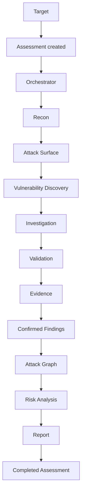

# Agent Architecture

Status: PLANNED
Related: [../agents/orchestrator.md](../agents/orchestrator.md) · [tool-architecture.md](tool-architecture.md) · [../data/observations.md](../data/observations.md)

## 1. What an "agent" is in OffensiveX

An agent is **not** a standalone AI feature bolted onto a dashboard. It is a bounded unit of work inside one coordinated assessment: an LLM session given (a) a specific objective, (b) a specific slice of assessment state to read, (c) a specific, small set of tools it may call through the Tool Registry, and (d) a specific, typed output it must produce. An agent run always belongs to exactly one assessment and is recorded as an `AgentRun` (see [../data/data-model.md](../data/data-model.md)) with its inputs, tool calls, and outputs retained for audit.

## 2. The seven agents

| Agent | Stage | One-line job |
|---|---|---|
| [Recon Agent](../agents/recon-agent.md) | Reconnaissance | Map the attack surface (hosts, ports, services, technologies, endpoints). |
| [Vulnerability Agent](../agents/vulnerability-agent.md) | Vulnerability discovery | Run and interpret vulnerability scanners against the mapped surface. |
| [Investigation Agent](../agents/investigation-agent.md) | Investigation | Chase up ambiguous or partial signals that scanners alone can't resolve. |
| [Validation Agent](../agents/validation-agent.md) | Validation | Confirm or reject a candidate finding with a controlled, non-destructive check. |
| [Attack Graph Agent](../agents/attack-graph-agent.md) | Attack-path construction | Turn assets + confirmed findings + relationships into graph edges. |
| [Risk Agent](../agents/risk-agent.md) | Risk analysis | Deterministically score findings using severity *and* graph position. |
| [Reporting Agent](../agents/reporting-agent.md) | Reporting | Assemble the evidence-linked report and write its prose sections. |

The Orchestrator is described separately ([../agents/orchestrator.md](../agents/orchestrator.md)) because it does not itself produce assessment content — it schedules the seven agents above and owns the state machine.

## 3. The assessment lifecycle

| Stage | What happens | Owner | On failure |
|---|---|---|---|
| Assessment created | Target, scope, and authorization are validated (Scope Guard, unchanged from the original design); an `Assessment` row is created in `pending`. | API / Orchestrator | Rejected with a reason; nothing is scheduled. |
| Recon | Recon Agent plans and runs DNS/port/HTTP tool calls through the Tool Registry; raw output becomes `Observation`s. | Recon Agent | Partial recon results are kept; the stage is marked `completed_with_errors`, not silently retried forever. |
| Attack Surface | The set of in-scope assets and services discovered so far, assembled from observations (not a separate agent — a materialized view). | Orchestrator | — |
| Vulnerability Discovery | Vulnerability Agent selects scanners appropriate to the discovered surface and runs them; output becomes more observations and `DISCOVERED` findings. | Vulnerability Agent | A scanner failure degrades that scanner's coverage; it does not fail the assessment. |
| Investigation | Investigation Agent reviews ambiguous/partial observations and findings, and may request further *read-only* tool calls to raise or lower confidence; moves findings `SUSPECTED → INVESTIGATING`. | Investigation Agent | Investigation that reaches no conclusion leaves the finding `SUSPECTED` and in the report as unconfirmed — it is not forced to a verdict. |
| Validation | Validation Agent runs a bounded, non-destructive check to move a finding to `CONFIRMED` or `REJECTED`; only runs when validation is enabled for the assessment (opt-in; see [../agents/validation-agent.md](../agents/validation-agent.md)). | Validation Agent | A validation check that errors (not "rejects") leaves the finding `VALIDATING`/unresolved, visibly, rather than guessing. |
| Evidence | Every agent and tool call that contributed to a finding attaches evidence (request/response, output, screenshot) as it happens — not a separate pass. | All agents | A finding with no evidence cannot become `CONFIRMED` (carried over from the original finding model). |
| Confirmed Findings | The set of findings with `status = CONFIRMED`, each with ≥ 1 evidence item. | — | — |
| Attack Graph | Attack Graph Agent builds nodes/edges from assets, relationships, and confirmed findings (and, by rule, well-evidenced `SUSPECTED` findings flagged as `potential` edges — see [../data/attack-graph.md](../data/attack-graph.md)). | Attack Graph Agent | A graph build failure leaves the previous graph in place, marked stale. |
| Risk Analysis | Risk Agent computes a deterministic, path-aware score per finding. | Risk Agent (deterministic, not an LLM call) | — |
| Report | Reporting Agent assembles the structured report sections and writes prose (executive summary, remediation framing) grounded in the above. | Reporting Agent | A reporting failure does not lose assessment data; the assessment stays `completed`, report generation can be retried. |
| Completed Assessment | Terminal state. | Orchestrator | — |

## 4. Retry and failure handling

- Every agent run is a `AgentRun` row with `status ∈ {queued, running, succeeded, failed, cancelled}` and bounded `attempts` — the same at-least-once, lease-based execution model as the original job queue (ADR-004), just applied to agent runs instead of pipeline steps.
- A failed agent run does not fail the whole assessment by default: recon/vulnerability/investigation/validation failures degrade that stage's coverage and are shown as such in the dashboard and report ("partial results — tool X failed"). Only a failure in a stage with no usable output at all (e.g. recon produced zero assets) blocks the assessment from progressing, because later agents have nothing to work from.
- Cancellation (operator-initiated) stops the orchestrator from scheduling further agent runs and terminates any running sandboxed tool process; already-produced observations/findings/evidence are kept.

## 5. Why agents don't talk to each other directly

Agents communicate **only** by reading and writing typed assessment state (observations, findings, evidence, graph, risk) through the database — never by passing free-form messages to one another. This keeps every intermediate result inspectable and auditable, and means an agent's behavior is fully determined by (its prompt, its tools, and the assessment state it's given), which is what makes agent runs replayable for debugging and for the audit log.
