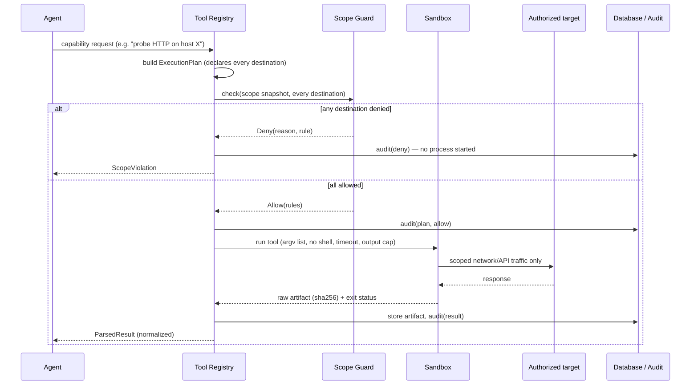

# Execution Model

Status: PLANNED
Related: [tool-architecture.md](tool-architecture.md) · [../tools/sandbox.md](../tools/sandbox.md) · [security-boundary.md](security-boundary.md)

## The path every tool call takes

This is the original Execution Engine sequence (ADR-006, Architecture §5 of the superseded design — see [../Architecture.md](../Architecture.md)) unchanged in its guarantees, with one addition: the caller on the left can be an **agent's** capability request as well as a fixed pipeline step's.

## Guarantees (unchanged from the original design, carried forward)

| Guarantee | Mechanism |
|---|---|
| No out-of-scope traffic | Every declared destination checked before anything runs; resolved IPs pinned; redirects re-checked per hop. |
| No shell injection | Tools run as an argv list, never through a shell; untrusted strings never interpolated into a command line. |
| Bounded resource use | Wall-clock timeout, output-size cap, concurrency cap per assessment, tool-native rate limits set from the assessment's scan mode. |
| Clean cancellation | Each tool process runs in its own process group; cancellation kills the whole tree. |
| Full audit trail | Plan, scope decision, and result are each written to the hash-chained audit log — whether the caller was a human-triggered step or an agent. |
| Dry run | The same path up to the scope-check step, then stops and reports the plan — no traffic sent. Available for agent-proposed actions as well as manual scans. |

## What's new: bounding an agent's *choice* of actions, not just its actions

A fixed pipeline step always runs the same tool with the same arguments; the only thing to bound was the destination. An agent *chooses* which capability to invoke and with what parameters, so the execution model adds one more check ahead of the Scope Guard:

| Check | What it enforces |
|---|---|
| **Toolset membership** | An agent may only request capabilities listed in its own agent definition (e.g. the Recon Agent cannot request a shell-execution capability — see [../agents/recon-agent.md](../agents/recon-agent.md)). |
| **Intrusiveness ceiling** | A capability whose `intrusiveness` exceeds the assessment's scan mode (Quick/Standard/Deep — see [../security/validation.md](../security/validation.md)) is refused regardless of which agent asked. |
| **Validation gate** | Any capability marked `requires_validation_mode` (i.e., it would actively attempt to trigger a vulnerability rather than only observe) is refused unless the assessment has validation explicitly enabled (opt-in; see [../agents/validation-agent.md](../agents/validation-agent.md)). |

These checks run **before** the Scope Guard and are equally fail-closed: a denial here produces no `ExecutionPlan` at all, so there is nothing for the Scope Guard to even evaluate. Both layers are enforced in the Tool Registry, the one chokepoint through which every tool call — human-triggered or agent-initiated — must pass.
