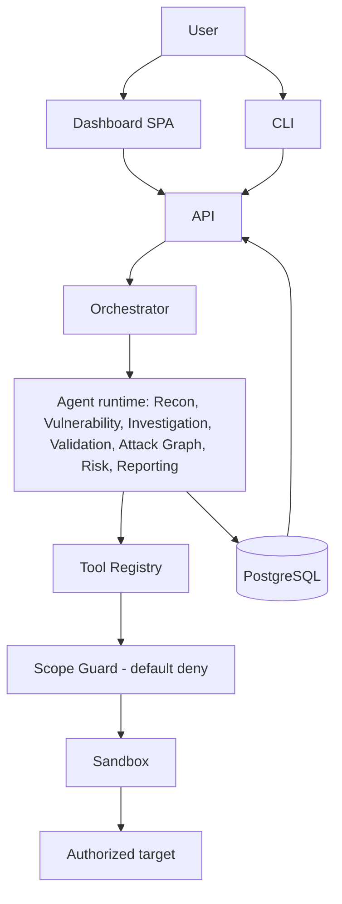

# Implementation Summary

Status: PLANNED — read this document first, before writing any code. It is the single developer-facing entry point; it references the detailed documents rather than duplicating them. No component described here exists yet — see [../roadmap/current-status.md](../roadmap/current-status.md).

---

## 1. Product definition

OffensiveX is an autonomous, AI-assisted penetration-testing platform for **authorized** security assessments. An orchestrator coordinates seven specialized agents over a sandboxed, scope-checked Tool Registry; raw tool output becomes evidence-backed findings; confirmed findings and asset relationships build an attack graph; a deterministic risk engine scores findings by what they let an attacker reach next, not just by isolated severity. **Attack-path intelligence and risk propagation is the stated core differentiator.** Full detail: [overview.md](overview.md) · [../README.md](../README.md).

## 2. Architecture diagram



Full diagrams and runtime topology: [system-architecture.md](system-architecture.md).

## 3. Assessment lifecycle

```
Target → Assessment created → Orchestrator → Recon → Attack Surface → Vulnerability Discovery
       → Investigation → Validation (opt-in) → Evidence → Confirmed Findings
       → Attack Graph → Risk Analysis → Report → Completed Assessment
```

Stage-by-stage owner/failure-mode table: [agent-architecture.md §3](agent-architecture.md#3-the-assessment-lifecycle). Transition-level input/output/DB/event/failure detail: [../roadmap/implementation-blueprint.md §2](../roadmap/implementation-blueprint.md#2-complete-assessment-flow-trace).

## 4. Agent architecture

Seven agents, one orchestrator. Only three are LLM-driven in the open-ended sense (Investigation, and the sequencing judgment in Recon/Vulnerability); **Attack Graph and Risk are deterministic engines, not LLM calls** — this is load-bearing for score/path reproducibility. Full per-agent contracts: [../agents/orchestrator.md](../agents/orchestrator.md) and the seven docs it links; compact implementation-facing contracts: [../roadmap/implementation-blueprint.md §4](../roadmap/implementation-blueprint.md#4-agent-contracts).

## 5. Tool architecture

Agents never call tools directly — they request a capability from the **Tool Registry**, which resolves it, scope-checks every declared destination, and runs it in the sandbox. One contract (`plan()`/`parse()`) for every tool. Full detail: [tool-architecture.md](tool-architecture.md), [../tools/tool-registry.md](../tools/tool-registry.md); registry contract + honest tool-by-tool status: [../roadmap/implementation-blueprint.md §5](../roadmap/implementation-blueprint.md#5-tool-registry-contract).

## 6. Domain model

Thirteen entities: `Target`, `Authorization`, `Assessment`, `Asset`, `Observation`, `Finding`, `Evidence`, `AgentRun`, `ToolExecution`, `AttackNode`, `AttackEdge`, `AttackPath`, `Report` (+ `RiskAssessment`, flagged as a possible overlap with `Finding`'s inline risk fields — resolve at P13, default to inline). Full field/relationship/lifecycle/owner table: [../roadmap/implementation-blueprint.md §3](../roadmap/implementation-blueprint.md#3-canonical-domain-model); conceptual model: [../data/data-model.md](../data/data-model.md).

## 7. Event model

Sixteen lifecycle events (`assessment.created` → `assessment.completed`), all persisted, none requiring real-time transport for MVP (poll-based dashboard refresh is sufficient — no message bus until a specific feature needs sub-second updates). Full table: [../roadmap/implementation-blueprint.md §6](../roadmap/implementation-blueprint.md#6-event-model).

## 8. API structure

REST, `/api/v1`, session auth, role-gated. Grouped by Assessment / Assets / Findings / Evidence / Attack Paths / Risk (nested) / Agents / Reports / Targets. Every row marked **CURRENTLY REQUIRED** or **FUTURE** against the MVP vertical slice. Full surface: [../roadmap/implementation-blueprint.md §7](../roadmap/implementation-blueprint.md#7-api-surface); conventions: [../interfaces/api.md](../interfaces/api.md).

## 9. Frontend structure

Dashboard, Assessment, Attack Surface, Findings, Finding Details, Evidence (embedded), Attack Graph, Risk (embedded), Agent Activity, Reports. **The frontend is never the source of truth** — every view reads persisted state through the API; the one write path (`PATCH /findings/{id}/status`) is an explicitly audited analyst override. Full per-screen data/API/event/action table: [../roadmap/implementation-blueprint.md §8](../roadmap/implementation-blueprint.md#8-frontend-surface); design detail: [../interfaces/dashboard.md](../interfaces/dashboard.md).

## 10. Security boundaries

Scope enforcement is unchanged and non-negotiable (default-deny, four-layer, fail-closed — [../Guardrail.md §2](../Guardrail.md#2-scope-mandatory-default-deny)). Agent agency is **bounded, not absent**: every tool call passes toolset-membership, intrusiveness-ceiling, and validation-gate checks in the Tool Registry *before* the Scope Guard even runs, and the Validation Agent is the only agent ever permitted a state-changing capability, only its one pre-reviewed per-class check, only when the assessment's validation flag is explicitly on. Full detail: [security-boundary.md](security-boundary.md); binding rules: [../Guardrail.md](../Guardrail.md).

## 11. MVP

End-to-end, once, correctly: one web target → Recon (DNS+HTTP) → one vulnerability check → Investigation → Validation (one registered check) → Evidence → Confirmed Finding → Attack Graph (minimal rule set) → Risk (full formula) → Report (JSON+Markdown). Full definition and the recommended first vertical slice (a non-intrusive web-header/reflection-class finding, chosen specifically because it validates non-destructively and exercises every stage without pulling Validation into exploit-development territory): [../roadmap/implementation-blueprint.md §9–§10](../roadmap/implementation-blueprint.md#9-mvp-definition).

## 12. Implementation phases

P0 Foundation → P1 Domain model → P2 Assessment lifecycle → P3 Tool Registry → P4 Sandbox → P5 Agent framework → P6 Recon → P7 Observation/event system → P8 Vulnerability discovery → P9 Investigation → P10 Validation+Evidence → P11 Findings engine → P12 Attack graph → P13 Risk engine → P14 Reporting → P15 Dashboard → P16 CLI → P17 Cloud security → P18 CI/CD (starts early, runs alongside) → P19 MCP/integrations (deliberately last). Full per-phase components/dependencies/DB/API/agent/frontend/test breakdown: [../roadmap/implementation-blueprint.md §11](../roadmap/implementation-blueprint.md#11-implementation-phases).

## 13. Definition of done

A phase is done only when (per [../Guardrail.md §25](../Guardrail.md) via the status vocabulary, and [CLAUDE.md](../../CLAUDE.md)):

- its specific acceptance criteria (written immediately before the phase starts) are met;
- its tests pass, including the mandatory negative tests for any safety-critical code it touches (scope, authorization, the three Tool Registry gating checks, grounding);
- no component is marked `IMPLEMENTED` or `VERIFIED` in [../roadmap/current-status.md](../roadmap/current-status.md) until it has actually run and been checked;
- documentation affected by the phase (this file, the relevant `architecture/`/`agents/`/`data/` doc, [../Decision.md](../Decision.md), [../Memory.md](../Memory.md)) is updated in the same change, never left to drift;
- the phase report names anything from [../roadmap/architecture-risks.md](../roadmap/architecture-risks.md) that materialized and what was done about it.

**Before starting Phase 0:** read this document, [../Guardrail.md](../Guardrail.md), and [../roadmap/roadmap.md](../roadmap/roadmap.md) in full. Nothing else is a prerequisite.
