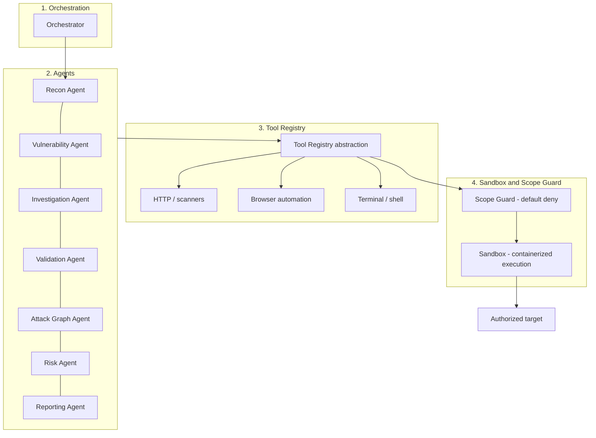

# Architecture Overview

Status: PLANNED
Related: [system-architecture.md](system-architecture.md) · [agent-architecture.md](agent-architecture.md) · [../Guardrail.md](../Guardrail.md)

## What OffensiveX is

OffensiveX runs **assessments** against **authorized** targets. An assessment is driven by an **orchestrator** that delegates work to **specialized agents** (recon, vulnerability discovery, investigation, validation, attack-graph, risk, reporting). Agents do not act freely — every action an agent takes against a target goes through the **Tool Registry**, which runs tools in a **sandbox** and is itself gated by the **Scope Guard** (carried over unchanged from the project's original safety design; see [../Guardrail.md](../Guardrail.md)). Raw tool output becomes structured **observations**, observations are correlated into candidate **findings**, findings are investigated and optionally **validated** (non-destructively, opt-in), validated findings and asset relationships build an **attack graph**, and the graph feeds a **risk engine** that scores findings by what they let an attacker reach — not just by isolated severity.

## Why an agent architecture

A fixed pipeline (fixed steps, fixed tool list per step) is easy to reason about but brittle: it cannot adapt its next action to what the last tool run actually found. An **agent** — an LLM given a narrow, well-defined toolset and a specific job — can look at an ambiguous signal (an odd response header, a partial injection reflection) and decide what to check next, the way a human tester would. OffensiveX adopts this pattern — **specialized agents over a tool abstraction, running in a sandbox, coordinated by an orchestrator** — because it is a good fit for the messy, exploratory middle of a pentest (investigation) that a deterministic pipeline handles poorly. This pattern is used by several public autonomous-pentesting projects, Strix among them; OffensiveX follows the same high-level shape for that reason, while its data model, attack-graph engine, and risk-propagation logic are its own design (see [../roadmap/current-status.md](../roadmap/current-status.md) for exactly what is original vs. inspired).

Not every stage benefits from an agent. **Reconnaissance** is still largely deterministic tool orchestration (DNS, port scan, HTTP probe) — an agent decides *which* recon tools to run and in what order based on what the target looks like, but it does not "reason" about a port list. **Risk scoring** and **attack-graph construction** are deliberately **not** agentic: they are deterministic engines, so a risk number is always reproducible and explainable (see [../security/risk-analysis.md](../security/risk-analysis.md)). Agency is used where judgment helps (investigation, validation planning) and withheld where determinism and reproducibility matter more (scoring, graph construction, scope enforcement).

## The four architectural layers



| Layer | Role | Detail |
|---|---|---|
| 1. Orchestration | Owns the assessment lifecycle: creates it, schedules agents, tracks state, enforces dependencies between stages, handles retries/failure. | [agent-architecture.md](agent-architecture.md), [../agents/orchestrator.md](../agents/orchestrator.md) |
| 2. Agents | Each agent has one job, a narrow toolset, and produces one kind of output (observations, candidate findings, validation results, graph edges, risk scores, a report). | [../agents/](../agents/orchestrator.md) |
| 3. Tool Registry | The *only* way an agent touches the outside world. Normalizes every tool (scanner, browser, shell) behind one interface so agents are not coupled to a specific binary. | [tool-architecture.md](tool-architecture.md), [../tools/tool-registry.md](../tools/tool-registry.md) |
| 4. Sandbox + Scope Guard | Every tool invocation is scope-checked (default deny, carried over from the original design) and runs inside an isolated, resource-limited container. | [security-boundary.md](security-boundary.md), [../tools/sandbox.md](../tools/sandbox.md) |

## Data flow, end to end

```
Target + authorization + scope
        │
        ▼
   Orchestrator creates an Assessment
        │
        ▼
   Recon Agent  ──tool calls──▶ Tool Registry ──▶ Sandbox ──▶ target
        │  (raw tool output)
        ▼
   Observations (normalized, typed, confidence-scored)
        │
        ▼
   Vulnerability Agent + Investigation Agent ──▶ correlate observations ──▶ candidate Findings
        │
        ▼
   Validation Agent (opt-in, non-destructive) ──▶ Evidence ──▶ Findings: CONFIRMED / REJECTED
        │
        ▼
   Attack Graph Agent ──▶ attack graph nodes/edges from assets + confirmed findings
        │
        ▼
   Risk Agent (deterministic) ──▶ path-aware risk score per finding
        │
        ▼
   Reporting Agent ──▶ evidence-linked report (JSON / SARIF / Markdown / PDF)
```

This is the same shape as the lifecycle in [system-architecture.md §4](system-architecture.md#4-end-to-end-lifecycle) and the finding/observation lifecycles in [../data/observations.md](../data/observations.md) and [../data/findings.md](../data/findings.md). Every arrow in this diagram is logged; nothing an agent does is invisible to the operator.

## What does not change from the original design

The project's non-negotiable safety rules — default-deny scope, mandatory authorization before any scan, sandboxed/non-shell tool execution, hash-chained audit log, no fabricated findings/CVEs, every claim grounded in evidence — carry over unchanged and are documented once, centrally, in [../Guardrail.md](../Guardrail.md). What changes is that an **LLM-driven agent**, not only a human operator, can now be the thing requesting a tool call — so those rules are re-read in [security-boundary.md](security-boundary.md) specifically for what an agent is and is not allowed to trigger.
