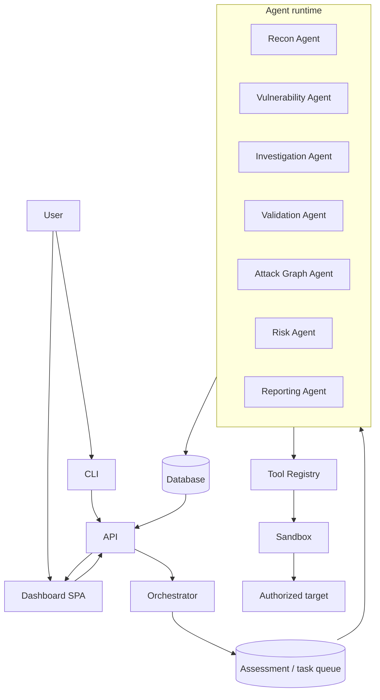

# System Architecture

Status: PLANNED
Related: [overview.md](overview.md) · [agent-architecture.md](agent-architecture.md) · [execution-model.md](execution-model.md)

## 1. Component diagram

## 2. Why this shape

- **One orchestrator, many narrow agents.** A single agent that "does the whole pentest" is hard to constrain and hard to debug. Splitting by responsibility (recon vs. investigation vs. validation) means each agent has a small, reviewable toolset and a single kind of output, and failures are isolated to one stage.
- **One tool abstraction.** Every agent calls tools the same way (see [tool-architecture.md](tool-architecture.md)), so adding a scanner or swapping an HTTP client does not touch agent logic, and every tool call can be scope-checked and audited in exactly one place — the same reasoning the original architecture used for the Execution Engine (ADR-006 in [../Decision.md](../Decision.md)) now extended to agent-initiated calls.
- **The database is the shared source of truth.** Agents do not pass state to each other directly; they read and write assessment state (observations, findings, evidence, graph, risk) through the database, so the orchestrator can always answer "what has happened in this assessment so far" without asking an agent.
- **Deterministic engines stay deterministic.** The attack graph and risk engine are not LLM calls — they are ordinary code operating on data the agents produced. This is what makes a risk score reproducible and a report defensible.

## 3. Runtime topology (planned)

| Process | Role |
|---|---|
| `api` | REST API, auth, assessment CRUD, serves the dashboard SPA. |
| `orchestrator` | Claims queued assessments, schedules agent runs, enforces stage dependencies, handles retries. |
| `agent-worker` | Executes one agent run at a time (an LLM session with a bounded toolset); horizontally scalable. |
| `sandbox` (containers) | Ephemeral, resource-limited containers that actually run tools against the target; one assessment's tool traffic never shares a container with another's. |
| `postgres` | Assessments, observations, findings, evidence, attack graph, risk, reports, audit log. |

This mirrors the original deployment shape (API + worker + Postgres, Docker Compose, no Kubernetes/queue broker — see ADR-002 through ADR-005, ADR-016 in [../Decision.md](../Decision.md)); the "worker" role is renamed/split into `orchestrator` + `agent-worker` to reflect that work units are now agent runs, not fixed pipeline steps, and `sandbox` becomes an explicit, separately-hardened runtime for tool execution rather than code running inside the worker process.

## 4. End-to-end lifecycle

See the full stage-by-stage description in [../roadmap/current-status.md](../roadmap/current-status.md) and the lifecycle diagram in [agent-architecture.md §3](agent-architecture.md#3-the-assessment-lifecycle). In one line: `Target → Assessment created → Orchestrator → Recon → Attack Surface → Vulnerability Discovery → Investigation → Validation → Evidence → Confirmed Findings → Attack Graph → Risk Analysis → Report → Completed Assessment`.

## 5. Relationship to the original design

| Original concept | Carried forward as |
|---|---|
| Execution Engine (single choke point for tool calls) | Tool Registry + Sandbox (same guarantees — scope check, no shell, timeouts, audit — now also invoked by agents, not only fixed pipeline steps). |
| Scan orchestrator (fixed pipeline of steps) | Orchestrator (schedules **agents**, not fixed steps; still owns state machine, retries, cancellation). |
| Canonical finding model | Unchanged in substance, extended with the observation→finding lifecycle (see [../data/findings.md](../data/findings.md)). |
| Risk engine (deterministic, versioned) | Unchanged in principle; now explicitly path-aware by design, not as an add-on (see [../security/risk-analysis.md](../security/risk-analysis.md)). |
| Attack graph engine (rule-based) | Promoted from "one more engine" to the project's stated core differentiator (see [../data/attack-graph.md](../data/attack-graph.md)). |
| LLM service with "no tools, no agency" | Replaced by the agent model, with agency **bounded** by the Tool Registry and Scope Guard instead of **absent** (see [security-boundary.md](security-boundary.md)). This is the one deliberate reversal from the original Guardrail text, and is called out explicitly there. |
