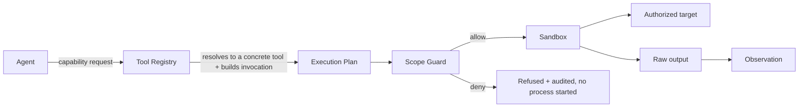

# Tool Architecture

Status: PLANNED
Related: [../tools/tool-registry.md](../tools/tool-registry.md) · [execution-model.md](execution-model.md) · [security-boundary.md](security-boundary.md)

## Why an abstraction, not direct calls

An agent must never be coupled to "call Nmap with these flags." It should ask for a capability — *discover open TCP ports on this host* — and the **Tool Registry** resolves that to a concrete tool, builds the concrete invocation, and routes it through the same scope-check-then-sandbox path every tool call takes, regardless of who asked for it (a human-triggered scan step or an agent). This is the direct descendant of the original project's "one Execution Engine for every tool call" rule (ADR-006/ADR-007 in [../Decision.md](../Decision.md)) — only now the caller is sometimes an agent's tool-use request instead of a fixed pipeline step.



## Tool categories

| Category | Capability examples | Status |
|---|---|---|
| Reconnaissance | DNS resolution, TCP port/service discovery, subdomain enumeration | PLANNED |
| Web | HTTP request/response, browser automation, proxy/interception | PLANNED |
| Vulnerability | Template-based web scanning, dependency/container scanning, static analysis | PLANNED |
| Execution | Sandboxed shell, sandboxed Python, Docker-in-sandbox for scripted checks | PLANNED |

Full tool-by-tool detail, including which specific binaries are planned vs. implemented, lives in [../tools/tool-registry.md](../tools/tool-registry.md), [../tools/scanners.md](../tools/scanners.md), [../tools/browser.md](../tools/browser.md), and [../tools/terminal.md](../tools/terminal.md). **No tool below `IMPLEMENTED` status may be described as integrated** in any other document (see [../roadmap/current-status.md](../roadmap/current-status.md)).

## Contract every tool adapter satisfies

```
class ToolAdapter(Protocol):
    meta: AdapterMeta        # name, capability, intrusiveness, requires_validation_mode, status
    def plan(self, request) -> ExecutionPlan: ...   # declares every destination it will touch
    def parse(self, raw_artifact) -> ParsedResult: ...  # pure function, raw bytes -> typed result
```

- `plan()` must declare every destination (host/IP/URL) the tool will touch **before** it runs, so the Scope Guard can check all of them up front — an adapter cannot discover a new destination mid-run and visit it without a fresh plan/check.
- `parse()` is a pure function from raw artifact bytes to a typed `ParsedResult` (never a dict grab-bag) — the same requirement as the original adapter design (ADR-007), so parsers are independently testable from recorded fixtures.
- `intrusiveness` and `requires_validation_mode` let the registry refuse a tool call that exceeds what the assessment's scan mode and validation setting allow (see [../security/validation.md](../security/validation.md), [../architecture/execution-model.md](execution-model.md)).

## Where agent capability requests become `ParsedResult`s

An agent never receives raw tool stdout; it receives the same normalized `ParsedResult` a human-triggered step would, which both (a) keeps agent prompts small and structured instead of full of raw scanner noise, and (b) is what gets turned into `Observation`s by the normalizer described in [../data/observations.md](../data/observations.md). This also means the agent cannot "miss" sanitization or scope filtering that happens at the parse/normalize boundary — it only ever sees what already passed those checks.
