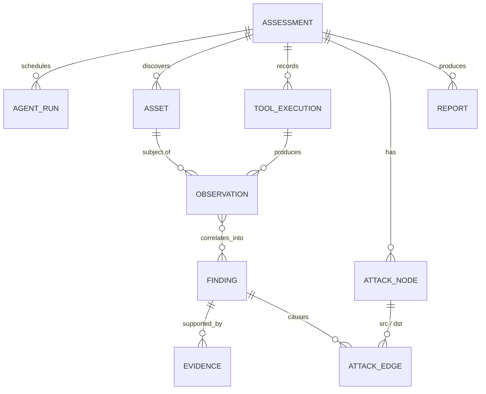

# Data Model

Status: PLANNED
Related: [findings.md](findings.md) · [observations.md](observations.md) · [attack-graph.md](attack-graph.md) · [evidence-model.md](evidence-model.md) · [../Decision.md](../Decision.md) (ADR-003, storage choice)

## Core entities

| Entity | What it represents |
|---|---|
| `Assessment` | One run of the full lifecycle against one target: scope snapshot, scan mode, validation flag, status. |
| `Target` / scope / authorization | Carried over unchanged from the original design (Guardrail §2); an assessment cannot be created without an approved, unexpired authorization and a non-empty scope. |
| `Asset` | A discovered host, port, service, application, endpoint, or cloud resource (see [../architecture/system-architecture.md](../architecture/system-architecture.md) for categories). |
| `ToolExecution` | One tool call made through the Tool Registry: which tool, which agent (if any) requested it, the scope decision, the raw artifact, timing. |
| `Observation` | A normalized, typed fact produced from a `ToolExecution`'s parsed output. See [observations.md](observations.md). |
| `Finding` | A candidate or confirmed weakness, correlated from one or more observations. See [findings.md](findings.md). |
| `Evidence` | A specific artifact (request/response, screenshot, command output, …) backing a finding. See [evidence-model.md](evidence-model.md). |
| `AttackNode` / `AttackEdge` | The attack graph for an assessment. See [attack-graph.md](attack-graph.md). |
| `AgentRun` | One execution of one agent (which agent, inputs, tool calls made, outputs, status, attempts). |
| `Report` | An immutable, generated snapshot of an assessment's results. |

## Storage

PostgreSQL only, carried over unchanged from the original design (ADR-003 in [../Decision.md](../Decision.md)): the attack graph is small enough per assessment (bounded node/edge counts) that a relational representation plus an in-memory graph library at query time is simpler than operating a separate graph database. This decision is revisited only if measured graph sizes in practice require it.

## Status note

No table above exists yet. This document specifies the planned shape; [../roadmap/current-status.md](../roadmap/current-status.md) is the source of truth on what has actually been migrated into a running database.
