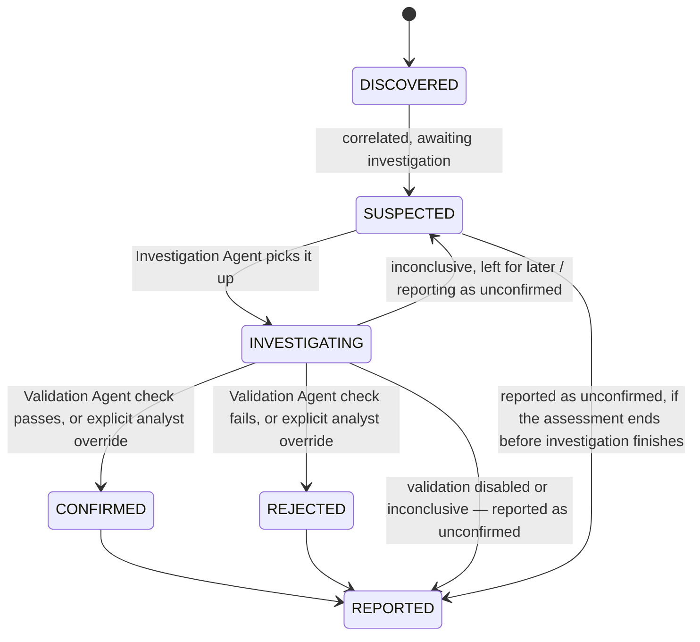

# Findings

Status: PLANNED
Related: [observations.md](observations.md) · [evidence-model.md](evidence-model.md) · [../security/validation.md](../security/validation.md)

## Lifecycle

**Only two things can move a finding to `CONFIRMED` or `REJECTED`: the Validation Agent's checked outcome, or an explicit, audited analyst override** (see [../agents/investigation-agent.md](../agents/investigation-agent.md) and [../agents/validation-agent.md](../agents/validation-agent.md), both of which state this explicitly). Investigation alone — however strongly evidenced — never promotes a finding past `INVESTIGATING`. If an assessment has validation disabled (the default), an investigated finding's ceiling is `INVESTIGATING`, reported as **unconfirmed**, unless an analyst manually confirms or rejects it through the explicit override path. (An earlier version of this diagram allowed "strongly evidenced" findings to reach `CONFIRMED` without validation; that was a documentation contradiction, corrected here — see `roadmap/implementation-blueprint.md` §14.)

## Why scanner output should not automatically become a confirmed vulnerability

Explained in full in [../security/vulnerability-discovery.md](../security/vulnerability-discovery.md) and [../security/validation.md](../security/validation.md); in short: scanners produce hypotheses with a known false-positive rate, and reporting every hit as confirmed would mean OffensiveX occasionally reports something false as a real vulnerability — which the project's guardrails explicitly forbid (never "fabricate findings," [../Guardrail.md §3](../Guardrail.md#3-safety--never)).

## Confidence and evidence

Every finding carries a `confidence` (how sure the *current* evidence makes OffensiveX, distinct from any one observation's own confidence) and must have ≥ 1 linked `Evidence` item once it leaves `DISCOVERED` (see [evidence-model.md](evidence-model.md)). A finding with no evidence cannot be `CONFIRMED` — enforced in the data model, not only by convention, unchanged from the original design.

## Canonical fields (carried over from the original finding model, still applicable)

`id`, `assessment_id`, `asset_id`, `title`, `description`, `severity`, `confidence`, `cvss_score`/`cvss_vector` (only if a source provided them), `cve`/`cwe` (only if a source provided them), `source`, `source_reference`, `affected_component`, `status` (per the lifecycle above), `risk_score`/`risk_breakdown`/`risk_model_version` (written only by the Risk Agent), `first_seen`/`last_seen`.

## What's new since the pre-agent design

The original design had a simpler lifecycle (`open / accepted_risk / false_positive / fixed`, set directly by an analyst). The agent architecture inserts an **investigation and validation** phase *before* a finding is ever shown to an analyst as actionable, so `DISCOVERED → SUSPECTED → INVESTIGATING → CONFIRMED/REJECTED` happens automatically as part of the assessment, and the analyst-facing lifecycle (triage status: accept risk, mark fixed, etc.) applies afterward, to `CONFIRMED` findings, exactly as before.
